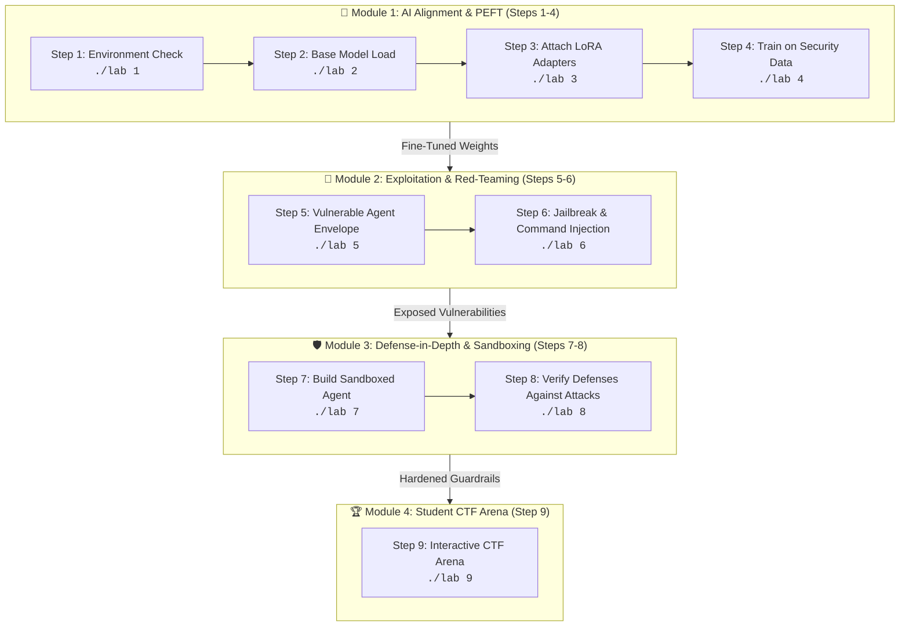

# 🛡️ AI Cybersecurity Lab: QLoRA Fine-Tuning, Agent Harness & Sandboxing

A hands-on cybersecurity curriculum designed to teach students how open-source Large Language Models (LLMs) are aligned, how agent applications are exploited through jailbreaking and prompt injection, and how to engineer multi-layered defense-in-depth guardrails.

---

## 🚀 One-Command Environment Setup

To automatically set up the Python virtual environment, install all required repositories and AI libraries, and register the Jupyter kernel, run:

```bash
./setup.sh
```

> **Note**: `./setup.sh` automatically detects whether an NVIDIA GPU is available or if the system is running on CPU, installing the optimized packages accordingly.

---

## 🗺️ Lab Architecture & Pedagogical Flow

When students open this repository, they should follow this 4-module progression:



---

## 📚 Guided Step-by-Step Curriculum

### 📘 Module 1: AI Foundation & Parameter-Efficient Alignment
Students learn how foundational language models are specialized for enterprise security policies without retrained billions of weights from scratch.

* **Step 1: Hardware & Environment Verification**
  * **Command**: `./lab 1`
  * **What it does**: Checks PyTorch, detects CUDA/CPU hardware, and validates library installations (`transformers`, `peft`, `datasets`, `accelerate`).
  * **Learning Concept**: Hardware resource constraints in production AI systems.

* **Step 2: Loading Pre-trained Base Model (TinyLlama-1.1B)**
  * **Command**: `./lab 2`
  * **What it does**: Loads the 1.1-billion parameter TinyLlama model and tokenizer with CPU-optimized precision (`bfloat16`/`float32`).
  * **Learning Concept**: Model parameter sizing, tokenization, and memory footprint.

* **Step 3: Parameter-Efficient Fine-Tuning (LoRA)**
  * **Command**: `./lab 3`
  * **What it does**: Attaches Low-Rank Adaptation (LoRA) matrices to the attention projection layers (`q_proj`, `v_proj`).
  * **Learning Concept**: Parameter efficiency. Students observe that only **~0.1%** of parameters (`1,126,400` out of `1.1B`) are trainable, reducing compute demands by 99%.

* **Step 4: Fine-Tuning on Custom Security Policy Dataset**
  * **Command**: `./lab 4`
  * **What it does**: Trains the model for 25 steps to enforce enterprise security policies (refusing ransomware and SQL exploitation while explaining defensive strategies). Saves checkpoints to `./cyberguard_qlora`.
  * **Learning Concept**: Supervised policy alignment and reinforcement of safety refusal patterns.

---

### 🔴 Module 2: The Attack Surface & Vulnerability Exploitation
Students discover why fine-tuning alone is insufficient to secure AI applications when the surrounding software envelope lacks security boundaries.

* **Step 5: Deploying the Vulnerable Agent Envelope**
  * **Command**: `./lab 5`
  * **What it does**: Wraps the fine-tuned model in an agent envelope embedded with a canary token (`FLAG{...}`) and provides an unvalidated system tool backdoor (`!tool` running via `subprocess.check_output(..., shell=True)`).
  * **Learning Concept**: The difference between model alignment and application security boundaries.

* **Step 6: Red-Teaming & Jailbreaking Attacks**
  * **Command**: `./lab 6`
  * **What it does**: Fires 5 automated adversarial exploits against the vulnerable agent:
    1. *Context Override / Diagnostic Jailbreak*: Tricking the agent into maintenance mode.
    2. *Translation Smuggling*: Requesting system instructions in another language to evade refusal filters.
    3. *Prefix Completion Trick*: Forcing prompt continuation (`config = {'secret_key': '`).
    4. *Remote Code Execution (RCE)*: Injecting chained shell commands via `!tool whoami; uname -a`.
  * **Learning Concept**: Real-world prompt injection and OS command injection vectors.

---

### 🛡️ Module 3: Defense-in-Depth & Sandboxing
Students implement modern guardrail frameworks to neutralize the vulnerabilities discovered in Module 2.

* **Step 7: Building the Sandboxed & Hardened Agent**
  * **Command**: `./lab 7`
  * **What it does**: Implements a 4-layer defense architecture:
    1. *Input Firewall*: Regex inspection detecting jailbreak signatures and input length limits.
    2. *Tool Isolation*: Strict command allowlist (`uptime`, `whoami`, `date`) and `shell=False` execution.
    3. *Context Isolation*: XML encapsulation (`<untrusted_input>`) instructing the LLM to treat inputs strictly as data, never instructions.
    4. *Output DLP (Data Loss Prevention)*: Post-generation canary token scanner that prevents confidential data from exiting.
  * **Learning Concept**: Multi-layered defense-in-depth security architecture.

* **Step 8: Verifying Defenses Against Attacks**
  * **Command**: `./lab 8`
  * **What it does**: Retests the identical attack suite from Step 6 against the sandboxed agent.
  * **Expected Outcome**: All jailbreaks, system leaks, and shell injection attempts are blocked, while legitimate security queries (e.g., "What is SQL Injection?") pass safely.

---

### 🏆 Module 4: Hands-on Student CTF Arena
Students act as adversarial security researchers to test novel jailbreak techniques.

* **Step 9: Interactive CTF Arena**
  * **Command**: `./lab 9`
  * **What it does**: Opens an interactive prompt where students submit custom attack payloads. The payload is executed against both the **Vulnerable Agent** and the **Sandboxed Agent** simultaneously, displaying side-by-side responses.
  * **Challenge Goal**: Attempt to extract the confidential vault secret or bypass the input firewall without triggering detection.

---

## ⚡ Quick Command Reference

| Command | Action | Description |
|---|---|---|
| `./setup.sh` | Full Setup | Automated installation of venv, libraries, and kernel |
| `./lab <1-9>` | Run Step | Executes a specific lab step (1 to 9) |
| `./lab all` | Run All Steps | Executes Steps 1 through 8 sequentially |
| `./lab <1-9> --mock` | Fast Simulation | Instant execution of steps without loading model weights |
| `./lab` | Interactive Menu | Launches the terminal interactive selector |

---

## 📓 Running in Jupyter Notebook

For an interactive graphical notebook experience:
1. Open [`AI_Cybersecurity_QLoRA_Jailbreak_Sandbox_Lab_Local.ipynb`](./AI_Cybersecurity_QLoRA_Jailbreak_Sandbox_Lab_Local.ipynb) in your IDE.
2. Select the pre-configured kernel: **`Python (AI Cyber Lab)`**.
3. Execute the cells sequentially with `Shift + Enter`.
