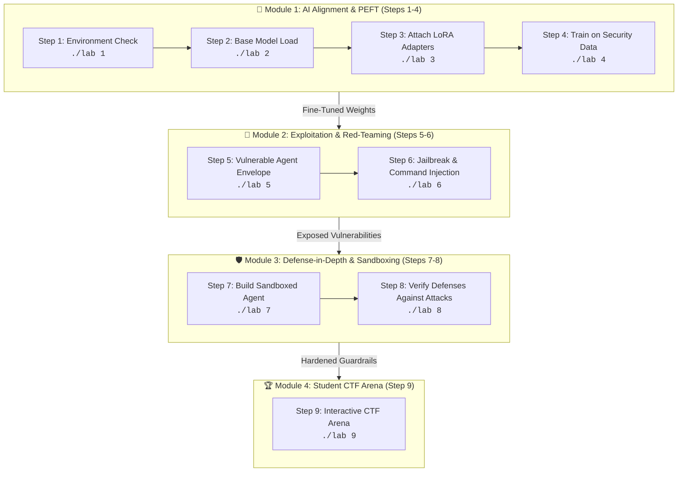

# 🛡️ AI Cybersecurity Lab: QLoRA Fine-Tuning, Agent Harness & Sandboxing

A **100% standalone local CLI environment** designed to run purely inside your Linux terminal. **No Jupyter Notebook, no Google Colab, and no cloud web interfaces required.**

---

## ⚡ Standalone Local Architecture

* **Pure Terminal Workflow**: Every step runs locally as an independent command or via an interactive terminal menu.
* **Offline Execution**: Model weights (`TinyLlama-1.1B`) are cached on local disk (`~/.cache/huggingface/hub/`) and execute directly on local CPU/GPU hardware.
* **Zero Browser Dependency**: No notebook server, token setup, or web browser is needed.

---

## 🚀 One-Command Local Environment Setup

To automatically configure the local virtual environment and install all necessary dependencies, run:

```bash
./setup.sh
```

`./setup.sh` automatically checks your hardware, configures a clean local `.venv`, installs CPU- or CUDA-optimized PyTorch and Hugging Face libraries, and verifies the environment by running Step 1.

---

## 🗺️ Lab Architecture & Module Flow



---

## 💻 Terminal Command Guide

### 1. Run Individual Steps
Run any step directly from your terminal using `./lab <step_number>` or `./run_step.sh <step_number>`:

```bash
./lab 1       # Step 1: Hardware & Library Verification
./lab 2       # Step 2: Load TinyLlama-1.1B Base Model into local memory
./lab 3       # Step 3: Attach LoRA Adapters (Rank=8, Alpha=16)
./lab 4       # Step 4: Fine-tune model on Cybersecurity Policy Dataset (25 steps)
./lab 5       # Step 5: Initialize Vulnerable Agent Envelope (with Canary Flag & RCE flaw)
./lab 6       # Step 6: Execute 4 Red-Teaming & Jailbreak attacks
./lab 7       # Step 7: Build Sandboxed Agent (WAF + DLP + Subprocess Isolation)
./lab 8       # Step 8: Retest attacks against Sandboxed Agent (verify 100% blocks)
./lab 9       # Step 9: Launch Interactive CTF Arena (custom prompt hacking)
```

### 2. Fast Simulation Mode (`--mock`)
To demonstrate attacks, defenses, and guardrails instantly without loading model weights into memory:
```bash
./lab 6 --mock    # Test Step 6 attacks instantly
./lab 8 --mock    # Test Step 8 defense blocks instantly
./lab all --mock  # Run Steps 1 through 8 sequentially in simulation mode
```

### 3. Interactive Terminal Console
Run `./lab` or `./run_step.sh` without arguments to launch the interactive terminal console:
```bash
./lab
```
You can choose any step by typing its number (1–9), type `all` to run sequentially, `m` to toggle mock mode, or `q` to quit.

---

## 📚 Step-by-Step Curriculum Overview

| Step | Script | Core Cybersecurity Concept |
|---|---|---|
| **Step 1** | `steps/step1_gpu_check.py` | Hardware inspection (CPU vs CUDA) and environment health verification. |
| **Step 2** | `steps/step2_load_model.py` | Loading foundational LLM architecture and parameter sizing (1.1 Billion parameters). |
| **Step 3** | `steps/step3_attach_lora.py` | Parameter-Efficient Fine-Tuning (PEFT/LoRA): training only **0.1%** of parameters. |
| **Step 4** | `steps/step4_train_qlora.py` | Policy alignment: training model to block ransomware and exploit requests while helping defense. |
| **Step 5** | `steps/step5_vulnerable_agent.py` | Naive wrapper vulnerabilities: secret canary token leaks and unsafe shell execution (`shell=True`). |
| **Step 6** | `steps/step6_redteam_attacks.py` | Real-world prompt injection: diagnostic overrides, translation smuggling, and command injection. |
| **Step 7** | `steps/step7_sandboxed_agent.py` | Defense-in-Depth: Input Regex Firewall + XML Context Isolation + Tool Sandbox (`shell=False`) + Output DLP. |
| **Step 8** | `steps/step8_test_sandbox.py` | Hardening verification: proving that attacks that succeeded in Step 6 are now blocked. |
| **Step 9** | `steps/step9_interactive_ctf.py` | Hands-on CTF arena: testing custom attack payloads against both agents side-by-side in terminal. |

---

## 📁 Repository File Layout

```text
├── lab                  # Master executable launcher (e.g. ./lab 1)
├── run_step.sh          # Shell wrapper script (e.g. ./run_step.sh 1)
├── setup.sh             # One-click pure local setup script
├── requirements.txt     # Python package requirements (pure CLI)
├── lab_runner.py        # Core CLI engine and interactive menu
├── cyber_lab_core.py    # Model loaders, agent classes, and guardrail functions
├── README.md            # Complete curriculum documentation
└── steps/
    ├── step1_gpu_check.py
    ├── step2_load_model.py
    ├── step3_attach_lora.py
    ├── step4_train_qlora.py
    ├── step5_vulnerable_agent.py
    ├── step6_redteam_attacks.py
    ├── step7_sandboxed_agent.py
    ├── step8_test_sandbox.py
    └── step9_interactive_ctf.py
```
